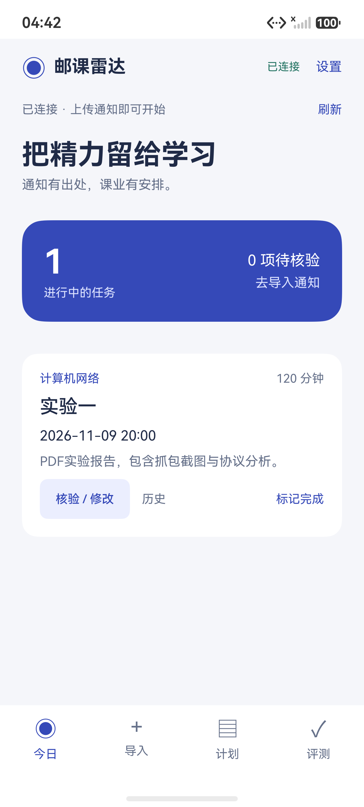
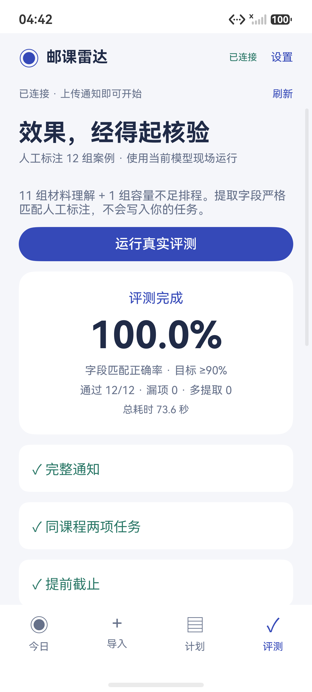

# 邮课雷达 · HarmonyOS 原生 AI 课业管家

**作业通知散在课程群，实验报告临时改截止时间，学习计划总要重新排。** 邮课雷达面向北邮等高校学生，把通知截图、文字与课程大纲整理成有原文依据、需要人工确认、可以重新排期的课业任务。

应用使用 **ArkTS / ArkUI 原生界面**，通过本机 FastAPI 后端接入兼容 OpenAI 格式的大模型。AI 理解通知，程序负责校验日期、保存历史与安排时间。

**导入通知 → 核验出处 → 确认任务 → 识别变更 → 重新排期 → 现场评测**

[下载模拟器演示包](https://github.com/pengliangtian06-commits/youke-radar/releases/tag/v0.1.0-demo) · [验证记录](reports/verification.md) · [架构说明](docs/architecture.md) · [三分钟演示](docs/demo-script.md)

2026-11-07 的验证中，后端自动测试 **29/29 通过**；HarmonyOS 手机模拟器中的文字通知、任务确认、截止变更、重新排期和重启后离线缓存已实际运行。应用内评测 **12/12 通过，标注字段匹配率 100%，耗时 73.6 秒**。这仅是当前小型人工构造测试集的一次运行结果，**不代表任意校园通知的通用准确率**。

后端图片和 PDF 的真实模型解析已通过；模拟器系统图片选择器的打开与取消已验证。完整的“手机选择图片/PDF → 上传”路径仍待验收。详细范围见[验证记录](reports/verification.md)。

## 已实现

- **ArkTS / ArkUI 原生手机应用**：今日、导入与核验、七天计划、真实评测四个入口。
- 图片 / 文字 / 文字型 PDF 解析；来源页码和原文片段；图片原图回看。
- 待确认任务、人工修改、预估工时、完成状态、保守关联变更、历史版本与并发冲突检查。
- 按截止时间优先的 30 分钟排程；避开课程；显示容量不足和截止日期缺失。
- SQLite 持久化；手机缓存最近确认任务与计划；失败可重试。
- 12 组人工标注评测，实际调用模型，不使用预设解析答案。

## 应用截图

下图为实际运行的原生应用，使用人工构造的演示任务。

<p>
  
  
</p>

## 本机快速运行

需要 Python 环境、支持文字及图片理解的大模型接口，以及 DevEco Studio 和已启动的鸿蒙手机模拟器。在项目根目录打开 PowerShell：

```powershell
python -m pip install -r backend/requirements.txt
if (-not (Test-Path .env)) { Copy-Item .env.example .env }
```

编辑 `.env`，填写服务地址、模型名称和密钥。服务地址须包含兼容接口前缀，例如 `https://服务域名/v1`；图片模型须支持 `image_url`。密钥只保留在本机后端，**不要提交或分享 `.env`**。配置完成后启动服务：

```powershell
powershell -ExecutionPolicy Bypass -File scripts/start-backend.ps1
```

服务默认仅监听 `127.0.0.1:8000`，接口文档为 <http://127.0.0.1:8000/docs>。这是单用户本机演示服务，未添加公网用户认证，不应直接对外开放。

## 鸿蒙工程与安装包

从 [GitHub Releases](https://github.com/pengliangtian06-commits/youke-radar/releases/tag/v0.1.0-demo) 下载 `entry-default-unsigned.hap`。它是**模拟器调试用未签名 HAP**，不是应用市场发布包，也不声称可直接在真机安装。二进制通过 Release 提供，不随源码仓库跟踪。

也可以在 DevEco Studio 中打开 `harmony/`，或运行以下命令。已验证工具链为 **DevEco Studio 26.0.0.865 Release**、SDK **26.0.0.105**、Hvigor **6.26.9**。编译与目标 SDK 固定为 26.0.0；最低兼容声明为 API 12，旧版本运行尚未验证。

```powershell
powershell -ExecutionPolicy Bypass -File scripts/build-harmony.ps1
```

本地构建完成后，产物位于 `dist/entry-default-unsigned.hap`。

在 Device Manager 创建手机模拟器并启动。已实际验证的设备是 **Mate 90 Pro 本地模拟器，HarmonyOS 7.0.0.107(SP8)，API 26**。

```powershell
powershell -ExecutionPolicy Bypass -File scripts/connect-emulator.ps1
$hdc = 'C:\Program Files\Huawei\DevEco Studio\sdk\default\openharmony\toolchains\hdc.exe'
# 按下载位置或本地构建位置修改路径
$hapPath = '.\dist\entry-default-unsigned.hap'
& $hdc install -r $hapPath
& $hdc shell aa start -a EntryAbility -b com.bupt.youkeradar
```

应用设置中的后端地址为 `http://127.0.0.1:8000`。`hdc rport` 将模拟器端口转接到电脑的本机服务；如果连接多个设备，需用 `hdc -t <设备标识>` 指定目标。DevEco Studio 安装目录不同时，可向脚本传入 `-DevEco` 参数。

镜像下载、虚拟化条件与账号登录属于模拟器首次准备步骤。已验证场景与未验证部分请查看[验证记录](reports/verification.md)。

## 现场演示

1. 导入页点击“填入演示通知”，再点击“提取任务”：这会真实调用模型，默认示例截止日期自动取未来日期。
2. 查看原文引用，确认工时，保存任务；计划页设置每天空闲时间并生成计划。
3. 导入页点击“填入变更通知”，解析后核验变化，确认保存，再到计划页重新安排。
4. 添加一条覆盖可用时间的课程时段，检查未安排工作量；导入缺少截止时间的通知，检查待确认提示。
5. 评测页运行 12 组案例，检查实际字段正确率、漏项、额外任务和失败原因。

`demo/` 中有人工构造的截图、PDF、变更通知与缺少日期的通知。将图片/PDF导入模拟器媒体库或文档目录后，可从系统选择器选取。`scripts/make-demo-materials.py` 可按当天日期重新生成；需要 Pillow、reportlab、pymupdf。

## 验证

```powershell
python -X utf8 -m pytest backend/tests -q
python -X utf8 scripts/evaluate.py
python -X utf8 scripts/smoke-inputs.py
```

后两项会使用 `.env` 配置发起真实模型请求，消耗该服务额度。评测不会写入用户任务。结果分别保存到 `reports/model-evaluation.json` 和 `reports/input-smoke.json`。

金标字段采用严格匹配；这是 12 组可重复演示案例，不代表通用准确率。变更候选仅在课程和任务名同时相同且匹配唯一时自动关联，其他情况由用户选择原任务。

## 数据与边界

图片引用是模型转录，应用明确提示用户对照原图；文字/PDF引用在服务端检查逐字存在。日期同时检查证据中日期与钟点的一致性。用户确认可以修正 AI 结果，手动修改会记录；原始提取引用不会被修改成伪造的“证据”。

通知仅在用户主动解析时发送到所配置的模型服务。后端保留材料用于回看；数据在 `data/` 中，仅限本地演示。仅支持 PNG/JPEG 图片、最多 30 页的文字型 PDF、单文件 10 MB；扫描 PDF 请转图片。排期不预测实际学习效率，不自动推断工时、不自动提交作业。

尚未包括微信/教务接入、推送提醒、多用户、桌面卡片、跨设备流转、部分实际学习耗时跟踪、真机签名和上架流程。重新排期按未完成任务的完整预估工时安排。
